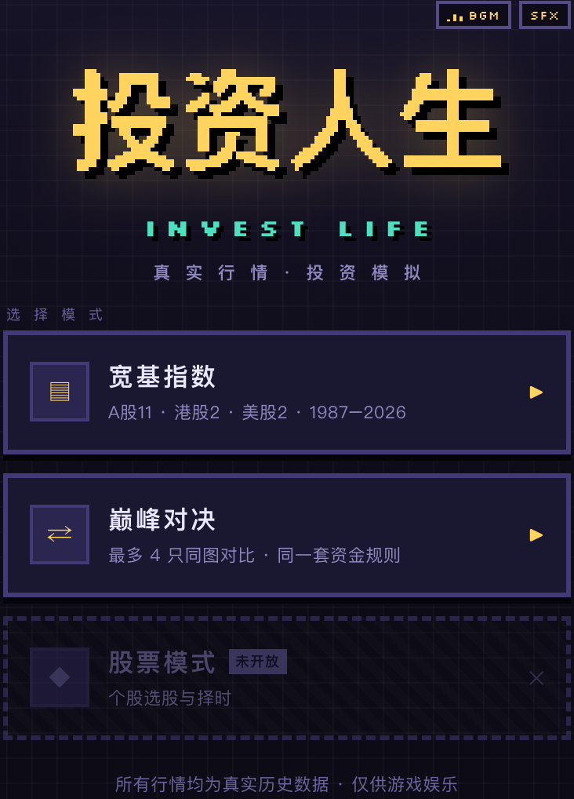
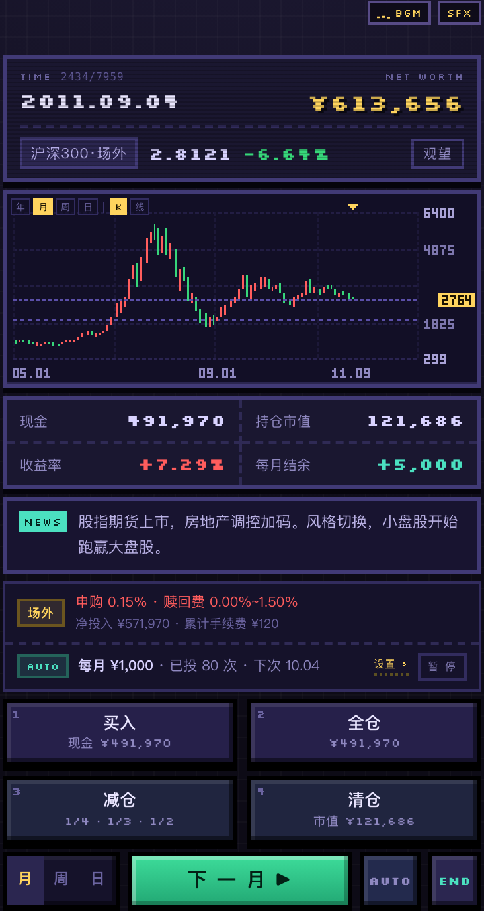
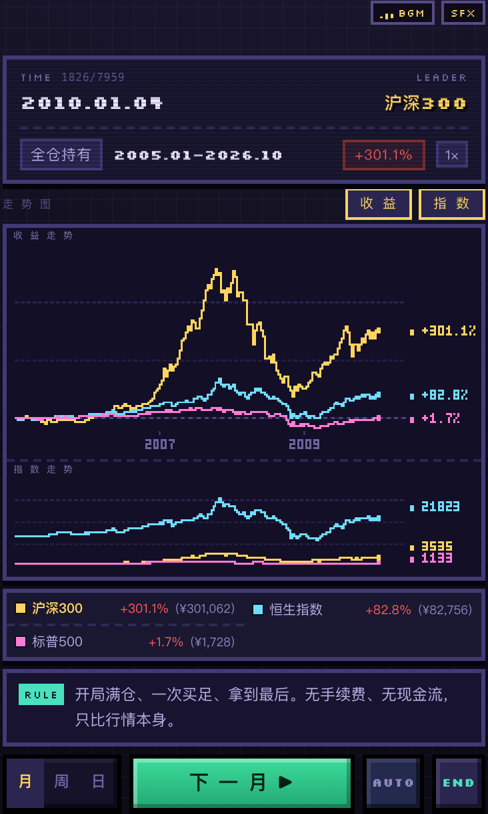
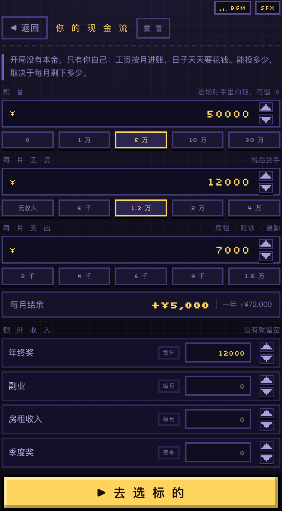
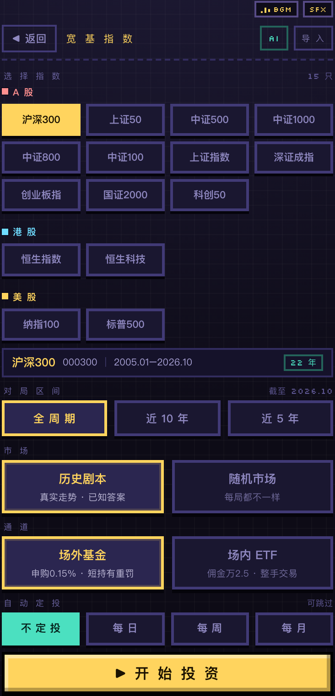
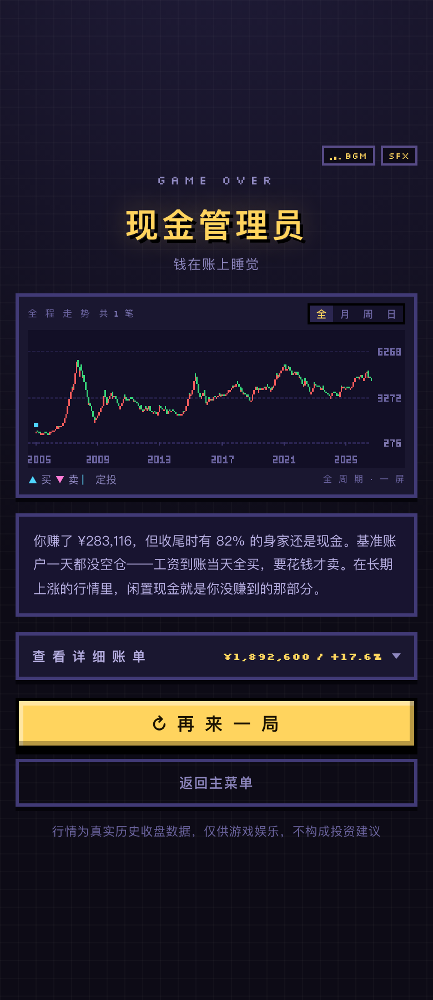

# 投资人生 · INVEST LIFE

> 用真实历史行情做的像素风投资模拟游戏。整个游戏就是一个 `index.html`，双击即玩，无需安装、无需联网。

**在线试玩 → <https://renzp94.github.io/invest-life/>**

不是「猜涨跌」的行情游戏，而是把**一个人的现金流**放进一段真实的指数历史里：工资按月到账，房租水电天天要花，能投多少取决于每月剩下多少。同一段行情里，有人靠定投攒下第一桶金，也有人满仓死在半山腰。

<p align="center">
  
  
  
</p>

## 两种玩法

| 模式 | 内容 |
| --- | --- |
| **宽基指数** | 单只指数的一生。15 只标的（A 股 11 · 港股 2 · 美股 2），行情最早可追到 1987 年，K 线可切年 / 月 / 周 / 日 |
| **巅峰对决** | 2–4 只指数同图对比。同一套资金规则、同一个起点，只比行情本身，看看长期到底谁跑赢谁 |
| 股票模式 | 开发中（未开放） |

## 界面

<table>
  <tr>
    <td align="center"><br><sub>开局先算清你的现金流</sub></td>
    <td align="center"><br><sub>选指数、区间、通道与定投</sub></td>
  </tr>
  <tr>
    <td align="center"><br><sub>对局：K 线、持仓、新闻、下单</sub></td>
    <td align="center"><br><sub>结算：评级、全程走势与账单</sub></td>
  </tr>
</table>

## 宣传片

<p align="center">
  
</p>

60 秒竖屏实机片：`docs/vlog/invest-life-publish.mp4`（1080×1920 · 30fps · 配乐 + 烧字幕 + 封面）。mp4 不入库，本地用脚本生成：

```bash
npm run record   # 无头 Chrome 逐帧录实机（docs/vlog/*.mp4）
npm run vlog     # 合成 8-bit 配乐 → 混音 → 烧字幕 → 出封面
```

配乐是 `scripts/vlog-audio.py` 用标准库现合成的，字幕时间轴在 `scripts/publish-video.mjs` 的 `TIMELINE`，改一行重跑即可。

## 玩法

### 你的现金流

开局没有本金，只有你自己。积蓄、月薪、月支出、额外收入（年终奖 / 副业 / 房租 / 季度奖）四项决定你每月能拿出多少钱。右上角实时显示「每月结余」，这是这局游戏真正的燃料。

生活费按天扣，工资按月发。现金不够时不会强行平仓，只记一笔「缺口」，但那笔钱你确实没付出去。

### 交易

| 通道 | 费率 |
| --- | --- |
| 场外基金 | 申购 0.15%，持有越短赎回费越高（最高 1.5%） |
| 场内 ETF | 佣金万 2.5（最低 5 元），整手 100 份成交 |

买入 / 全仓 / 减仓（1/4 · 1/3 · 1/2）/ 清仓四个动作，金额既可按比例也可手输。定投支持每日 / 每周 / 每月，金额档位从 ¥300 到 ¥5,000 或自定义。

### 区间与市场

对局区间可以选全周期、近 10 年或近 5 年。市场还能切「历史剧本 / 随机市场」——前者是真实走势、答案已知，后者每局重新生成 10 年行情，背答案没用。

### 时间推进

日 / 周 / 月三档粒度，`AUTO` 自动连播，`END` 直接跳到结局。K 线可切年 / 月 / 周 / 日，支持 K 线与折线两种画法，悬浮可看每一根的具体读数。

### 结算

先拆一个信封，再看成绩单：评级（比如「现金管理员」）、全程走势、与「发薪就买、要花就卖」基准账户的对比点评，以及可展开的详细账单。

### 巅峰对决

- 2–4 只指数，同一区间、同一本金，规则完全一致
- 策略：**全仓持有**（一次买足拿到最后）或**网格**（跌多少补一成 / 涨多少减一成）
- 播放倍速 0.5×–4×，手动单步也行
- 走势图可切换「收益走势」（纵轴收益率）与「指数走势」（纵轴真实点位），可同时看两张，也可以只看一张
- 悬浮看任意一天各只指数的点位与涨幅，暴涨暴跌有独立特效
- 结算给出排名、净值、收益率与最大回撤

## 数据

- 全部为**真实历史行情**，内联在 `index.html` 里，游戏运行时不发任何网络请求。
- 格式：`["YYYY-MM-DD", 开, 收, 高, 低]`，日频；也兼容 `["YYYY-MM", ...]` 月频与只给收盘价的两项格式。
- 指数本身没有复权问题，用价格指数 + 年均股息率折算全收益；分红按年再投资。
- 采集脚本在 `scripts/`：`fetch-daily.mjs` 走东方财富日线（不复权），`fetch-ohlc.mjs` 走腾讯月 K，都带「日期升序 + 不重复 + OHLC 自洽」的校验，对不上就跳过，不会写坏已有数据。

> 数据仅用于游戏娱乐，不构成任何投资建议。

## 运行

```bash
open index.html          # macOS
# 或者直接双击 index.html
```

不需要本地服务器 —— 数据已经全部内联，`file://` 打开即可。

## 构建与开发

源码是 `src/template.html`，数据是 `data/indexes.json`，两者由 `build.js` 合并成 `index.html`。所有命令都通过 npm 脚本调用，没有第三方依赖，只需要 Node ≥ 18：

| 命令 | 作用 |
| --- | --- |
| `npm run build` | 校验数据并产出 `index.html` |
| `npm run check` | 只校验、不写文件（改完数据先验一遍，或放进 CI） |
| `npm run dev` | 构建 + 起本地服务 + 监听改动热重建，自动刷浏览器 |
| `npm run serve` | 只起静态服务（`--no-watch --no-open`），给手机同网调试用 |

`npm run dev` 默认开在 <http://127.0.0.1:5173/>，端口被占用会自动顺延，并在浏览器里注入一小段自动刷新脚本；改 `src/` 或 `data/` 下任何文件，服务会重新构建（约 200 ms）再刷新页面。这段脚本只存在于开发服务的响应里，不会写进 `index.html`。常用参数：

```bash
npm run dev -- --port 8080     # 换端口
npm run dev -- --no-open       # 不自动开浏览器
npm run dev -- --no-watch      # 不监听文件，只预览
```

构建时会校验每个标的的字段、粒度、日期顺序与 OHLC 自洽性，有任何一条不合格就直接报错，不产出半成品。

```
invest-life/
├── src/template.html       # 唯一源文件：结构 + 样式 + 全部游戏逻辑
├── data/
│   ├── indexes.json        # 行情数据（构建时内联）
│   └── PROMPT.md           # 让 AI 按格式产出数据的提示词
├── scripts/
│   ├── dev.mjs             # 开发服务：热重建 + 自动刷新
│   ├── record.mjs          # 录制演示视频（CDP 逐帧 + ffmpeg）
│   ├── fetch-daily.mjs     # 日线更新与对账
│   └── fetch-ohlc.mjs      # 月 K OHLC 补齐
├── docs/
│   ├── screenshots/        # 界面截图
│   └── vlog/               # 演示视频与发布文案（mp4 不进仓库）
├── build.js                # 内联构建（--check 只校验）
├── package.json            # npm 脚本入口
└── index.html              # 产物，可直接运行（约 4.2 MB）
```

## 在线试玩

<https://renzp94.github.io/invest-life/>

部署走 GitHub Actions（`.github/workflows/deploy.yml`），不占 `gh-pages` 分支，也不需要本地打包上传。触发方式两种：

| 动作 | 结果 |
| --- | --- |
| 推送到 `main` | 重新构建并发布，线上始终是最新代码（发版就是往 `main` 推） |
| Actions 页面手动 Run workflow | 想重发一次时用 |

打 `v*` 标签只作为版本标记，不单独触发部署 —— `github-pages` 这个 environment 默认只允许从默认分支部署，tag 会被保护规则拒绝。真要「打 tag 即发版」，去 Settings → Environments → `github-pages` → Deployment branches and tags 里加一条 `v*` 规则，再把 workflow 的 `tags` 触发加回来即可。

每次发布都会先跑 `npm run build`，数据校验不过就直接失败，不会把坏包发上线；站点里只放 `index.html` 一个文件（Gzip 后几百 KB），源码、数据、截图都留在仓库。

首次需要在 **Settings → Pages → Build and deployment** 把 Source 设为 **GitHub Actions**。这一步只能用仓库管理员操作，`GITHUB_TOKEN` 没有创建 Pages 站点的权限（会报 `Resource not accessible by integration`），所以没法在 workflow 里代办；设置一次之后，后续每次推送都会自动发布，不用再管。

## 换成你自己的数据

两种方式：

1. **临时试玩**：游戏里选「宽基指数」→ 右上角「导 入」→ 选中 JSON 文件。
2. **永久内置**：把数据合并进 `data/indexes.json` 的 `items` 数组，再跑 `node build.js`。

不知道格式怎么写？`data/PROMPT.md` 里有一段可以直接丢给 AI 的提示词（游戏配置页右上角的「AI」按钮里也是同一段），说清标的和时间范围，它会按格式返回 JSON。要点是**必须是日频、日期升序不重复、最高价 ≥ 开收、最低价 ≤ 开收**，少于 400 个交易日会被拒绝。

## 键盘

| 按键 | 对局 | 巅峰对决 |
| --- | --- | --- |
| `空格` / `→` | 走一步 | 走一步 |
| `Enter` | 自动播放 / 暂停 | 自动播放 / 暂停 |
| `1` `2` `3` `4` | 买入 / 全仓 / 减仓 / 清仓 | — |
| `Esc` | 关闭弹窗 | 关闭弹窗 |

## 技术说明

单文件、零依赖、纯 Canvas。画布内部只有 240 像素宽，靠 `image-rendering: pixelated` 放大，所以文字、图标、分隔线全是手绘像素，连百分比符号也是点阵字。整个页面没有一张位图素材，所有图形都是运行时画出来的。

---

行情数据来自公开历史行情接口，仅供学习与娱乐。
